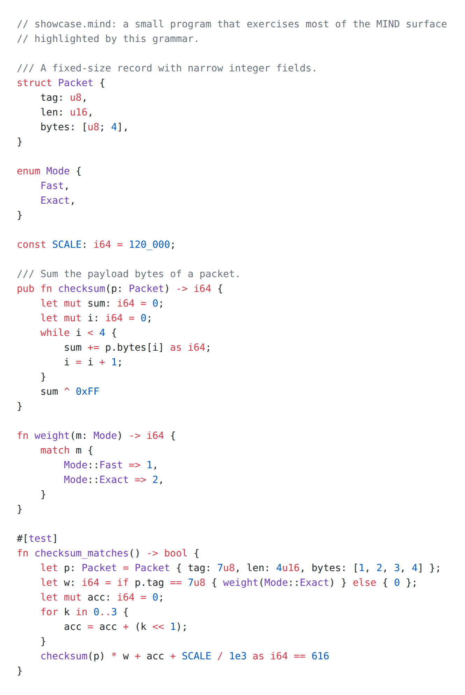

<p align="center">
  <picture>
    <source srcset="images/mind-grammar.svg">
    
  </picture>
</p>

<h1 align="center">MIND-Grammar</h1>

<p align="center">
  TextMate grammar that gives editors syntax highlighting for MIND source files (<code>.mind</code>).
</p>

<p align="center">
  <picture>
    <source media="(prefers-color-scheme: dark)" srcset="images/showcase-dark.png">
    
  </picture>
</p>

## What it is

- `source.mind.json`: one TextMate grammar, scope name `source.mind`, for files ending in `.mind`.
- `language-configuration.json`: comment toggling, bracket matching, auto-closing pairs and indentation rules for VS Code.
- `package.json`: a VS Code extension manifest that registers the `mind` language and the grammar.

Any editor or tool that reads TextMate grammars can use `source.mind.json` directly. The screenshots above were made with [Shiki](https://shiki.style) (`npm run screenshots`).

## Status

- Tracks the MIND 0.10.x surface language. Checked against the parser of the reference compiler `mindc` 0.10.2 and the lexical chapter of [mind-spec](https://github.com/star-ga/mind-spec).
- Tested with assertion tests, snapshot tests and a corpus check (see [Testing](#testing)).
- Not published to the VS Code Marketplace or Open VSX. Install it from a locally built `.vsix` (below).

### What is highlighted

| Area | Covered |
|------|---------|
| Comments | `//` line comments, `///` doc comments (`////` stays a plain comment), nested `/* */` block comments as defined in the spec. `mindc` 0.10.2 only accepts line comments, so the editor config never inserts block comments. |
| Attributes | `#[test]`, `#[collapse]`, `#[repr(C)]`, `#[name(args)]` in general |
| Declarations | `fn`, `struct`, `enum`, `type`, `trait`, `impl`, `module`, `invariant`, `const`, `let` / `let mut`, `pub`, `extern "C"` blocks with `unsafe fn` / `safe fn` |
| Control flow | `if` / `else` (including value-if), `match` with `=>`, `for … in`, `while`, `loop`, `break`, `continue`, `return`, `region { }`, `assert`, `?` |
| Types | `i8` `i16` `i32` `i64` `u8` `u16` `u32` `u64` `isize` `usize` `f16` `bf16` `f32` `f64` `q16` `bool`; `tensor<f32[N]>`, `Tensor<f32, [N]>`, `diff tensor<…>`, `tensor<sparse[…], …>`; `[T; N]`, `&[T]`, `&mut T`, `*const T`; `Option`, `Result`, `String`; user types |
| Literals | decimal integers with `_` separators, `0x` / `0o` / `0b` integers, integer suffixes (`2u32`, `0xFFu8`, `0usize`), floats with exponents (`1.0e-5`, `1e5`), `true` / `false`, strings and character literals with the escapes `mindc` accepts (`\n \t \r \0 \\ \' \"`). Any other escape is marked invalid, because `mindc` rejects it. |
| Operators | arithmetic, comparison, logical, bitwise and shifts, compound assignment (`+=` … `>>=`), `@` matmul, elementwise `.+ .- .* ./`, ranges `..`, `as` casts, `::` paths, `->`, variadic `...` |
| Names | `import` / `use` / `export` module paths, function declarations and calls, `print(…)` and `grad(…)`, `__mind_*` intrinsics, `Some` / `None` / `Ok` / `Err`, `ALL_CAPS` constants |

Words that are keywords only in context stay plain identifiers elsewhere. For example, `diff` is a modifier only before `tensor`, and `region` is a keyword only before `{`. So `let mut diff: i64 = 0;` highlights as an ordinary variable.

## Quick start

### VS Code

Requires Node.js (latest LTS) and the `code` command on your `PATH`.

```sh
git clone https://github.com/star-ga/mind-grammar.git
cd mind-grammar
npm ci
npm run package                                   # writes mind-grammar-0.2.0.vsix
code --install-extension mind-grammar-0.2.0.vsix
```

Open any `.mind` file and it is highlighted.

### Shiki (websites, docs, static renderers)

```js
import { readFileSync } from "node:fs";
import { createHighlighter } from "shiki";

const mind = JSON.parse(readFileSync("source.mind.json", "utf8"));
const highlighter = await createHighlighter({
  themes: ["github-dark"],
  langs: [{ ...mind, name: "mind" }],
});
const html = highlighter.codeToHtml("fn main() -> i64 { 0 }", { lang: "mind", theme: "github-dark" });
```

### Other TextMate-based editors

Point the editor's TextMate grammar import at `source.mind.json` (scope `source.mind`, file extension `mind`).

## Testing

```sh
npm ci
npm test                 # assertion tests + snapshot tests + corpus check
```

- `tests/cases/*.mind`: assertion tests ([vscode-tmgrammar-test](https://github.com/PanAeon/vscode-tmgrammar-test)). Every `// ^^^ scope` line checks the scopes of the source line above it.
- `tests/snap/*.mind`: snapshot tests over real MIND sources, copied unchanged from the public [MIND repository](https://github.com/star-ga/mind) at commit `c0cceeb` (`std/vec.mind`, `std/string.mind`, `std/net.mind`, `std/async.mind`, `examples/policy.mind`, `examples/tiny_edge_model.mind`, `examples/cnn_classifier.mind`, `examples/mindc_mind/testdata/native_record_array/reference_u8.mind`). `samples/showcase.mind` is snapshotted too. Run `npm run test:snap:update` after an intended grammar change and review the diff.
- `npm run test:corpus -- <paths…>`: tokenizes every `.mind` file under the given paths and fails on any `invalid.*` token, or on a file that ends inside an unclosed string, comment or attribute. With no arguments it checks `tests/snap` and `samples`.

To check the grammar against a whole MIND checkout:

```sh
git clone https://github.com/star-ga/mind.git ../mind
npm run test:corpus -- ../mind/std ../mind/examples ../mind/tests
```

At commit `c0cceeb` of the MIND repository (version 0.10.2) this run reports `480 files, 109699 lines, 0 failing`.

`samples/showcase.mind` is a real program. It passes `mindc test samples/showcase.mind` with `mindc` 0.10.2. It is not in `mindc fmt` canonical form, on purpose: the formatter rewrites `120_000`, `0xFF`, `7u8` and `+=`, and those are the forms the screenshot needs to show.

Regenerate the screenshots (needs Chrome or Chromium on `PATH`, or set `CHROME_BIN`):

```sh
npm run screenshots
```

## How it uses MIND

The grammar follows the MIND reference compiler, not a generic C-like template:

- The keywords come from the `mindc` parser: its statement keyword table, type parser and expression parser.
- The number rules match `mindc`: radix prefixes, `_` separators, the ten integer suffixes, and the rule that `1..10` and `48.byte()` are not floats.
- The string and character escapes are the `mindc` escape table.
- Attribute syntax is `#[name(args)]`, as in RFC 0012.
- The tests run on real MIND sources from the standard library and the examples.

## License

Apache License 2.0. See [LICENSE](LICENSE).

## Links

- MIND language and docs: [mindlang.dev](https://mindlang.dev)
- MIND compiler and standard library: [github.com/star-ga/mind](https://github.com/star-ga/mind)
- MIND language specification: [github.com/star-ga/mind-spec](https://github.com/star-ga/mind-spec)
